# sattebazi: picking a fantasy XI before the toss

**Final model: the refined neural network with batter–bowler graph features (ADVM).** For each upcoming match it estimates every
squad member's expected fantasy points as *chance of playing × points if he plays*, then an exact optimiser picks the legal
11 with the largest total. Trained only on Cricsheet T20 / T20I matches dated up to 31 December 2025.

**Hidden test set:** [`results/hidden_predictions.csv`](results/hidden_predictions.csv): 88 fixtures (48 men's, 40 women's,
January to October 2026), 11 players each, in descending order of predicted points, with role, P(plays) and points if he plays.

| on the 2024 and 2025 seasons it never saw | 2024 | 2025 |
|---|---|---|
| points our 11 scored, as a share of the best possible 11 (picked in hindsight) | 62.45% | 63.34% |
| a random legal 11, for reference | 45.1% | 44.9% |
| MAE of predicted points, every squad member (sat-out = 0) | 25.79 | 25.35 |
| RMSE / rank correlation of players inside a match | 36.72 / 0.342 | 38.10 / 0.359 |

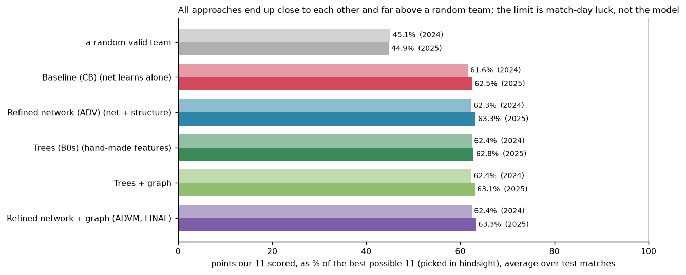

Contents: [1 reading the problem](#1-reading-the-problem) · [2 the approaches](#2-the-approaches) ·
[3 the final pipeline](#3-the-final-pipeline-refined-network--batterbowler-graph-advm) · [4 conclusion](#4-conclusion) ·
[5 how a model is judged](#5-how-a-model-is-judged) · [6 leakage audit](#6-leakage-audit) · [7 assumptions](#7-assumptions) ·
[8 how to run](#8-how-to-run) · [9 repository layout](#9-repository-layout) · [10 glossary](#10-glossary)

---

## 1. Reading the problem

### 1.1 What is actually being predicted

A player's fantasy score in a match is

```math
Y_i \;=\; \mathbb{1}[\,i \text{ plays}\,]\cdot\big(3 + \Phi(\text{what he does in the match})\big)
```

where $\Phi$ is the official points table (exact, implemented in `src/shared/preprocessing/points.py`) and 3 is the
appearance bonus. Taking expectations, with no independence assumed anywhere,

```math
\mathbb{E}[Y_i] \;=\; \underbrace{P(i \text{ plays} \mid \text{squad, context})}_{p_i}\;\cdot\;\underbrace{\mathbb{E}[Y_i \mid i \text{ plays}]}_{\mu_i}
```

A team's score is the sum of its 11 players' scores, so by linearity of expectation the best team *on average* is the legal
11 with the largest $\sum_i p_i\mu_i$. That last step is an exact optimisation (section 3.4). Everything difficult is in
estimating $p_i$ and $\mu_i$ before the toss.

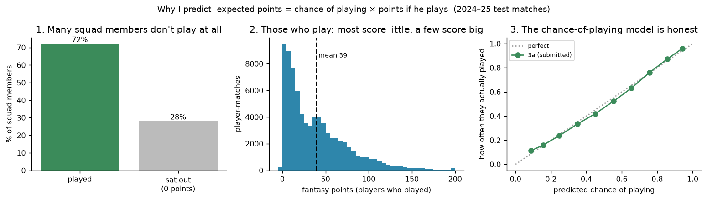

### 1.2 The bottlenecks

1. **Who plays is a competition inside the squad, not eleven separate yes/no questions.** A squad has two keepers: the first
   choice plays every match, the backup never does. A model that scores players one at a time learns that the backup is a
   player who "never plays" and drives his rating down. When the first choice is missing, the backup should be very likely
   to play, but nothing in his own history says so. *Ability belongs to the player; competition for a slot belongs to the
   squad.* A model has to keep the two apart.
2. **The labels do not exist.** Cricsheet has ball-by-ball events only: no squads, no roles, no fantasy points. All three had
   to be rebuilt: points from the deliveries; roles from past behaviour (stumpings, catches, share of overs, batting
   position: 99.3% of real XIs come out legal); and season squads (everyone who played for that team in that competition and
   season), so that benched players become "sat out, 0 points" rows. 28% of squad rows are such zeros.
3. **History is stale.** Training data stops on 31 December 2025 and the matches to predict come months later (the hidden
   set: 11 to 275 days later, median 139). A model tested on fresh history would look better than it is. So every model is
   trained and tested with history cut $\Delta$ days before each match:

   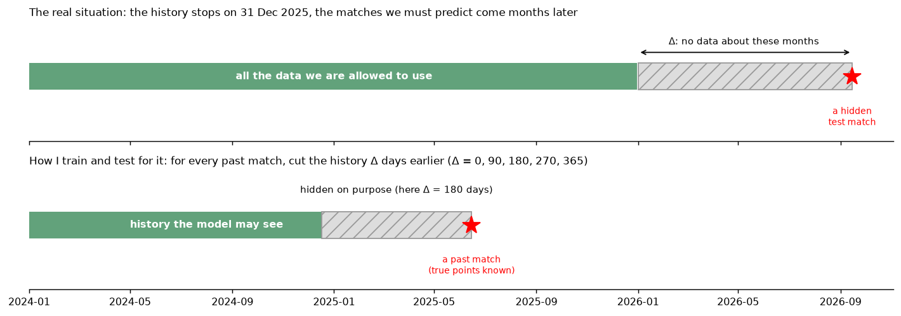

4. **Most of the variation is the day itself.** Only about 13% of the match-to-match variance in a player's points is
   explained by who the player is; points are heavy-tailed (most players score little, a few score 100+). This caps every
   model, and it is why the comparison between models needs paired bootstrap intervals (section 5).
5. **Leakage.** Every feature, squad, role and graph snapshot must be computable before the match it is attached to.

Here is one real match (the median of 40 mock matches), predicted by the trees (B0s) trained to 30 September 2025:

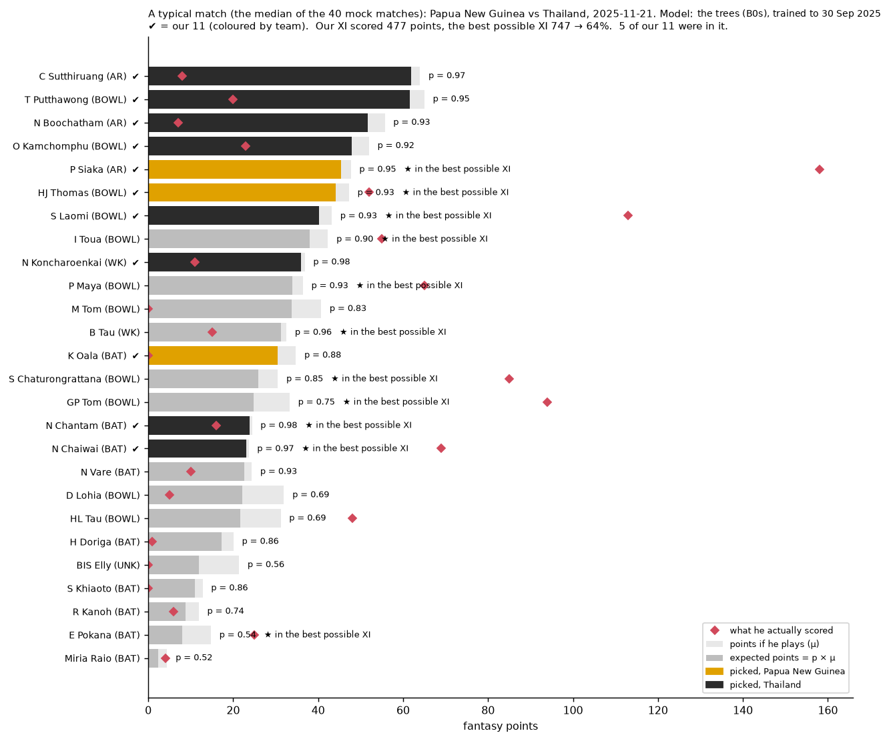

The picked players (✔) are the ones with the longest dark bars ($p\cdot\mu$), and the red diamonds show what they really
scored: one player we did not pick scored 158. That spread is bottleneck 4.

### 1.3 How I model it

| bottleneck | what the pipeline does |
|---|---|
| competition for places | model $p$ as a **choice of a whole XI among the squad** (refined network), or at least force each team's chances to add up to 11 (trees) |
| missing labels | rebuild points, roles and pseudo-squads; benched squad members are explicit zero rows |
| staleness | train with a random $\Delta \in [0, 450]$ days per fixture; test at $\Delta \in \{0, 90, 180, 270, 365\}$; $\Delta$ is an input |
| noise | judge on the task's own score (points of the picked 11), compare models per match with paired bootstrap intervals, decide with a rule written before any test number |
| the decision | maximise $\sum p_i\mu_i$ exactly under the team rules |

---

## 2. The approaches

All approaches share the same data pipeline, candidate sets, staleness protocol and optimiser, so differences in the results
come from the models alone:

| step | code | what it does |
|---|---|---|
| ingestion | `src/shared/ingestion/ingest.py` | Cricsheet JSON → matches and player-matches; T20 / IT20 dated ≤ 2025-12-31 only (13,085 matches); super overs excluded |
| fantasy points | `src/shared/preprocessing/points.py` | the official table as 13 components; band edges and real matches re-scored in `tests/test_points.py` |
| roles | `src/shared/preprocessing/roles.py` | keeper / batter / all-rounder / bowler as of each date |
| pseudo-squads | `src/shared/preprocessing/squads.py` | the candidates for each match, benched players included (median 15 per team) |
| features | `src/shared/preprocessing/causal.py`, `features.py`, `context.py` | everything through one strict "dated before" join |
| picking the XI | `src/shared/optimization/selection.py` | exact optimiser (section 3.4) |
| team overview (optional bonus) | `src/shared/llm/team_overview.py` | a small local open-weight model (Qwen2.5-0.5B-Instruct, Apache-2.0, CPU) phrases a short paragraph per predicted XI from facts the code computes and prints above it; greedy decoding, no API calls. Example: `results/mock_team_overviews.txt` |

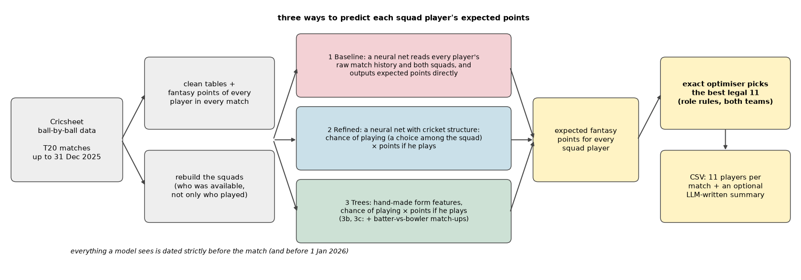

### 2.1 Approach 1: Baseline (CB), the network learns everything itself

**Idea.** Before putting any cricket knowledge in, find out what a model learns on its own. It is never told "keeper",
"form" or "probability of playing"; its results are the reference every idea has to beat.

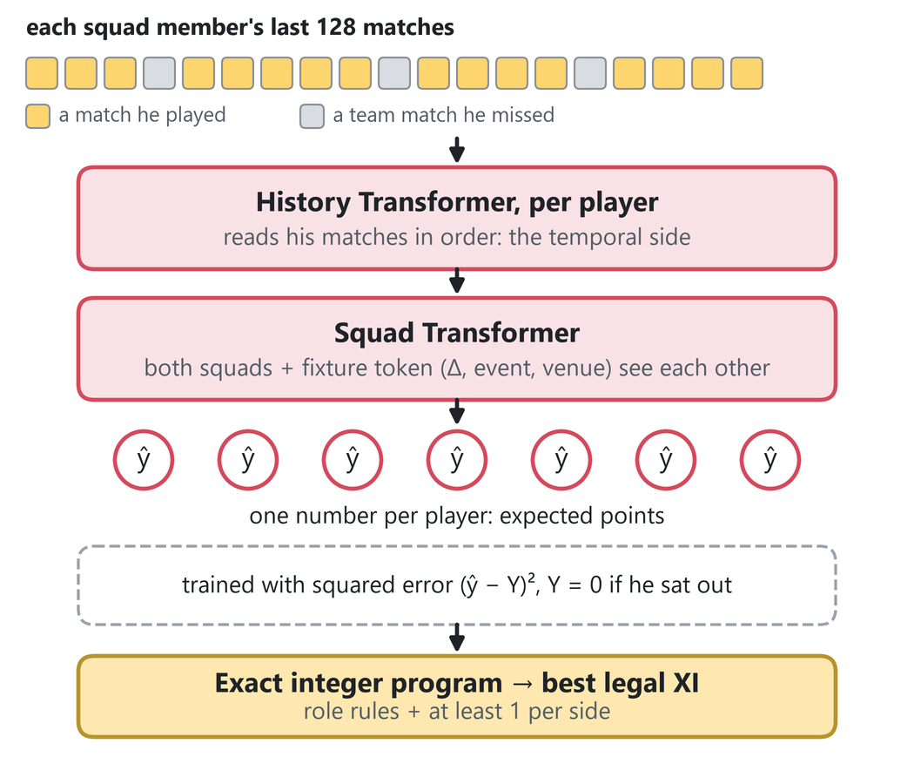

**Architecture** (`src/baseline/scoring_model.py`):
- each past match is one token: 16 raw counts (runs, balls, fours, sixes, wickets, dots, catches, …), the fantasy points he
  scored, the context (format, competition, venue, opponent, team) and how long ago it was. A second token type marks every
  match of his team he *missed* in the last year, so the model can see who is a regular and who was dropped;
- a **history Transformer** (2 layers, d = 64, 4 heads) reads each player's last $L$ tokens: the temporal side;
- a **squad Transformer** lets every candidate of both squads and one fixture token (match context, $\Delta$) attend to each
  other: the present side;
- one output per player, $\hat y_i$.

**Loss.** Plain squared error on every squad row, benched players included ($Y_i = 0$), each fixture weighted equally:

```math
\mathcal{L}_{\text{CB}} \;=\; \frac{1}{B}\sum_{f=1}^{B}\frac{1}{n_f}\sum_{i \in f}\Big(\frac{\hat y_i - Y_i}{\sigma_Y}\Big)^2
```

The minimiser of squared error is the conditional mean, and $\mathbb{E}[Y\mid x] = p\cdot\mu$, so the network has to learn
"plays" and "points if he plays" together without being told.

**Training.** AdamW, cosine schedule with warm-up, EMA weights, up to 20 epochs with early stopping on the October–December
validation window; two history lengths (64 and 128 matches) × two seeds; the seeds are averaged. 128 won on validation.

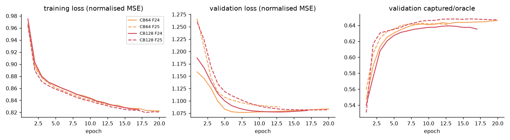

**Results.**

| | 2024 | 2025 |
|---|---|---|
| share of the best possible XI (history 128) | 61.65% | 62.54% |
| vs the trees (B0s), points per match | −5.34 [−8.26, −2.49] | −1.93 [−4.74, +0.90] |
| MAE / RMSE, every squad member | 24.75 / 33.91 | 24.22 / 33.67 |
| rank correlation inside a match | 0.318 | 0.341 |
| predicted team total vs real | −13% | −16% |
| picked players who actually played | 84% | 85% |

**Why it performs like this.** It does learn the task (54% → 65% of the best XI on validation), and it has the lowest MAE of
all models, because squared error on all squad rows is exactly what MAE-like metrics reward. But nothing tells it that exactly
11 players take the field: "will he play" and "how much" are mixed into one number, team totals come out 13–16% low, and it can
learn that the benched backup keeper simply never plays. Its whole gap to the others is at $\Delta = 0$; when everyone's history
is a year old it is level with them. That is the signature of a model that has not separated selection from ability.

### 2.2 Approach 2: Refined network (ADV), cricket structure built into the network

**Idea.** Same inputs and data as the baseline, but the architecture gets the structure I believe the problem has. Every piece
can be switched off to measure what it is worth.

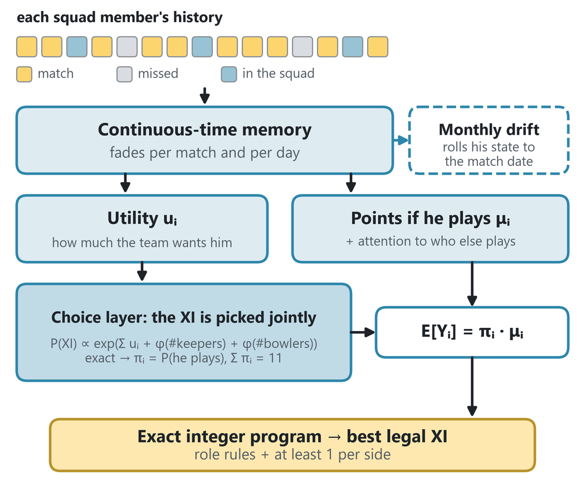

**Architecture** (`src/refined/scoring_model.py`, `src/refined/decision_model.py`):
- **continuous-time memory** (a WKV recurrence) reads each player's tokens; every channel decays per match *and* per day,
  so a long gap lowers the model's confidence instead of changing its opinion. A test checks that with fixed decays it
  reproduces the exponential moving averages the trees use (to 1e-16);
- **two heads**: a utility $u_i$ (how much his team wants him) and $\mu_i$ (points if he plays), both tied to what he can do
  (keep wicket, bowl, bat high); the match context rescales every player (FiLM: a flat pitch lifts every batter), and the
  $\mu$ head attends over both squads (a missing opener pushes No. 3 up);
- a **choice layer** that scores whole XIs (below);
- a **monthly drift** $g$ that rolls a player's state forward through the staleness gap.

**The choice layer.** For one team with candidates $i = 1..C$ that fields $n$ players (11, or 12 where impact substitutes
exist), with $k_i = 1$ for keepers and $b_i = 1$ for bowling options:

```math
P(X) \;=\; \frac{1}{Z}\exp\Big(\sum_{i\in X}u_i + \varphi_K\big(\min(K_X,3)\big) + \varphi_B\big(\min(B_X,8)\big)\Big)\,\mathbb{1}\big[|X| = n\big],
\qquad K_X=\sum_{i\in X}k_i,\; B_X=\sum_{i\in X}b_i
```

$Z$ sums the same exponential over **every** possible XI of the squad, computed exactly by a dynamic program over
(players picked, keepers, bowling options) in $C \times 14 \times 4 \times 9$ steps:

```math
\alpha_j(m,k,b) = \mathrm{logaddexp}\big(\alpha_{j-1}(m,k,b),\; \alpha_{j-1}(m-1,k-k_j,b-b_j) + u_j\big),\qquad
\log Z = \mathrm{logsumexp}_{k,b}\big(\alpha_C(n,k,b) + \varphi_K(k) + \varphi_B(b)\big)
```

A player's chance of playing is the total probability of the XIs that contain him, which falls out of $Z$ as a derivative:

```math
\pi_i = P(i\in X) = \frac{\partial \log Z}{\partial u_i},\qquad \sum_i \pi_i = n,\qquad \mathbb{E}[Y_i] = \pi_i\,\mu_i
```

This handles competition for places by construction: remove the first-choice keeper and the probability mass of the XIs that
contained him must flow somewhere (the $\pi_i$ still sum to $n$), and the XIs with no keeper at all are pushed down by
$\varphi_K(0)$, so it flows to the XIs containing the backup. His $\pi$ rises without any rule written for it. Checked against
brute force over all 364 XIs of a 14-player squad (difference $6\times10^{-15}$).

**Loss, in four training phases** (`src/refined/pipeline.py`):

- **P1, memory + heads + choice layer** (up to 15 epochs, patience 3): the negative log-likelihood of the real XI $X^\ast$ per
  selected player, plus squared error of $\mu$ on the players who played:

```math
\mathcal{L}_{\text{P1}} \;=\; \underbrace{\frac{1}{n}\Big(\log Z - \sum_{i\in X^\ast}u_i - \varphi_K(K_{X^\ast}) - \varphi_B(B_{X^\ast})\Big)}_{\text{who plays}}
\;+\; \underbrace{\frac{1}{|\text{played}|}\sum_{i\,\in\,\text{played}}\Big(\frac{\mu_i - Y_i}{\sigma_\mu}\Big)^2}_{\text{points if he plays}}
```

- **P2, the monthly drift** (encoder frozen): in training the matches inside the gap are known, so the true state at each month
  boundary $z_{k+1}$ is a target; $g$ learns one month of drift (with season phase, gender and team type as inputs); $\mathrm{sg}$ = stop-gradient, the target is not differentiated:

```math
\mathcal{L}_{\text{P2}} \;=\; \frac{1}{N}\sum_{k}\big\lVert\, g(z_k,\ \text{phase}_k,\ \text{gender},\ \text{type}) - \mathrm{sg}(z_{k+1}) \big\rVert^2
```

- **P3, heads on rolled-forward states**: a copy of the decoder is trained with $\mathcal{L}_{\text{P1}}$ on
  $z^\ast = g^{\lceil \Delta/30\rceil}(z_c)$, the December form rolled forward to the match date;
- **P4, a one-pass student** distilled from the rest, which failed (−17.5 and −14.0 points per match) and was dropped.

Each seed then picks its final predictor (direct or rolled forward) on validation; the two seeds are averaged.

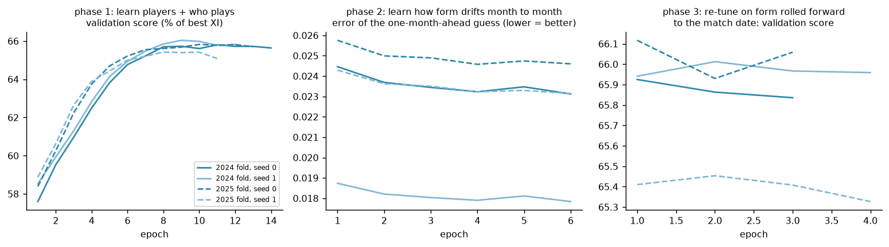
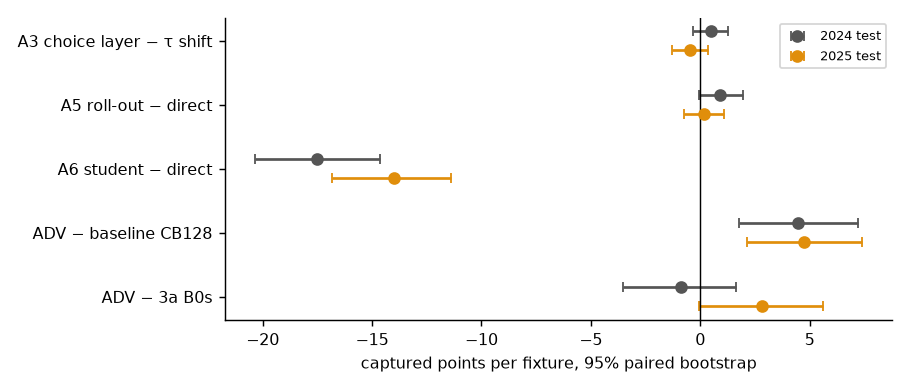

**Results.**

| | 2024 | 2025 |
|---|---|---|
| share of the best possible XI | 62.34% | 63.26% |
| **vs the baseline (CB)** | **+4.45 [+1.77, +7.22]** | **+4.76 [+2.15, +7.40]** |
| vs the trees (B0s) | −0.90 [−3.52, +1.63] | +2.82 [−0.06, +5.61] |
| choice layer vs a simple "sum to 11" shift (same weights) | +0.49 [−0.35, +1.27] | −0.47 [−1.27, +0.37] |
| rolled forward vs not | +0.91 [−0.07, +1.94] | +0.17 [−0.76, +1.08] |
| MAE / RMSE, every squad member | 25.90 / 36.78 | 25.53 / 38.33 |
| rank correlation inside a match | 0.341 | 0.359 |

Learned team-shape terms (2025 fold, seed 0): an XI with no keeper, or with 7+ bowling options, is less likely; five or six
bowling options is the normal shape.

| number in the XI | 0 | 1 | 2 | 3 | 4 | 5 | 6 | 7 | 8+ |
|---|---|---|---|---|---|---|---|---|---|
| $\varphi_K$ (keepers) | −0.46 | 0 | 0 | −0.26 (3+) | | | | | |
| $\varphi_B$ (bowling options) | −0.35 | −0.37 | −0.45 | −0.42 | −0.20 | 0 | 0 | −0.45 | −0.96 |

**Why it performs like this.**
- **Structure pays:** about +4.5 points a match over the baseline in both years, both intervals above zero. Same data, same
  inputs; the only difference is the structure.
- **Against the trees it ties on average, but the average hides a pattern:** the trees win only on fresh history
  ($\Delta = 0$), where "played the team's last match" is an extremely strong signal. As history gets older, the refined
  network leads, because its memory fades with real time and its choice layer reasons about the squad rather than about the
  player's last appearance.
- **Its MAE is higher than the baseline's while its teams are better.** The optimiser only needs the *order* of $p\cdot\mu$
  inside a match; the refined network's point *levels* drift (2025 validation MSE about 2,100 vs 1,180 for the others) while
  its ranking stays good. This is the clearest example of why MAE is not the selection metric (section 5).
- **The choice layer ties the simple fix on picked points** (the learned team-shape terms are mild, and most of the work is
  done by the utilities), but it handles the missing-keeper case by construction.

### 2.3 Approach 3: Trees (B0s) and the batter–bowler graph

**Idea.** Players do not score in a vacuum. Both earlier models describe a player by his own record, with the opponent as one
team-level number; summing each match into counts throws away who bowled to whom. Yet the opponent was the one context signal
that replicated (+2.6 points a match). A batter's runs depend on who bowls to him and a bowler's wickets on whom he bowls to:
that is a graph, every ball an edge between a batter and a bowler.

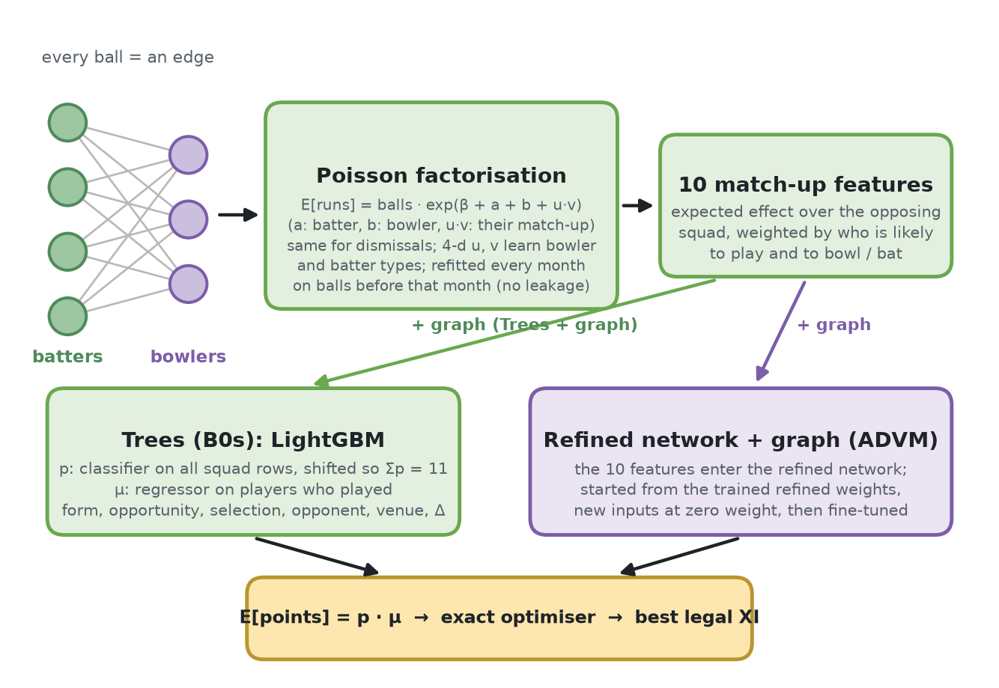

**The trees (B0s)** (`src/graph/scoring_model.py`): the $p\cdot\mu$ split done the classic way with gradient-boosted decision
trees (LightGBM), on hand-made features computed strictly before the cutoff: form as moving averages over 3, 10 and 30
matches plus career averages, opportunity (batting position, balls faced and bowled), how often he played for this team
recently and where he ranks inside his own squad, role evidence, own and opposing squad strength, a shrunk venue average,
and $\Delta$ itself. About 60 small experiments decided what goes in (`src/experiments/`, one line per run in
`results/experiments/LOG.txt`).

*Losses:* $\mu$ is an L2 regressor on the players who played; $p$ is a binary log-loss classifier on every squad row;
then one shift $\tau$ per team makes the chances add up to the XI size:

```math
\mathcal{L}_\mu = \frac{1}{|\text{played}|}\sum_{\text{played}}(\hat\mu_i - Y_i)^2,\qquad
\mathcal{L}_p = -\frac{1}{N}\sum_i \big[y_i\log\sigma(s_i) + (1-y_i)\log(1-\sigma(s_i))\big],\qquad
\sum_{i\in\text{team}}\sigma(s_i - \tau) = 11
```

Both early-stop on the October–December validation window.

**The batter–bowler graph** (`src/graph/graph_model.py`): 645k batter–bowler records (one per pair per match), 2.87M balls.
For runs and for dismissals separately, a pair's expected count given $n_{ij}$ balls is a rank-4 Poisson factorisation, fitted
by maximum a posteriori:

```math
\lambda_{ij} = n_{ij}\exp\big(\beta + a_i + b_j + \mathbf{u}_i^{\top}\mathbf{v}_j\big),\qquad
\mathcal{L}_{\text{graph}} = \sum_{(i,j)} w_{ij}\big(\lambda_{ij} - y_{ij}\log\lambda_{ij}\big)
+ \frac{\lVert a\rVert^2 + \lVert b\rVert^2}{2\cdot 0.3^2} + \frac{\lVert u\rVert^2 + \lVert v\rVert^2}{2\cdot 0.15^2}
```

with recency weights $w = 0.5^{\text{age}/730\text{ days}}$. The vectors are short, so a batter who handles a *kind* of bowler
handles every bowler of that kind, including ones he has never faced; the bowler vectors group bowlers by type without any
label (Cricsheet has no bowling-style field), and the priors pull pairs with few balls towards the average. The graph is refitted
every month on balls bowled before that month (100 snapshots, 2017-10 → 2026-01); a row with cutoff $c$ uses the latest
snapshot on or before $c$. Before the toss nobody knows who will bowl to whom, so each player gets the *expected* effect over the
opposing squad, weighted by how likely each opponent is to play and to bowl (or bat): 10 features.

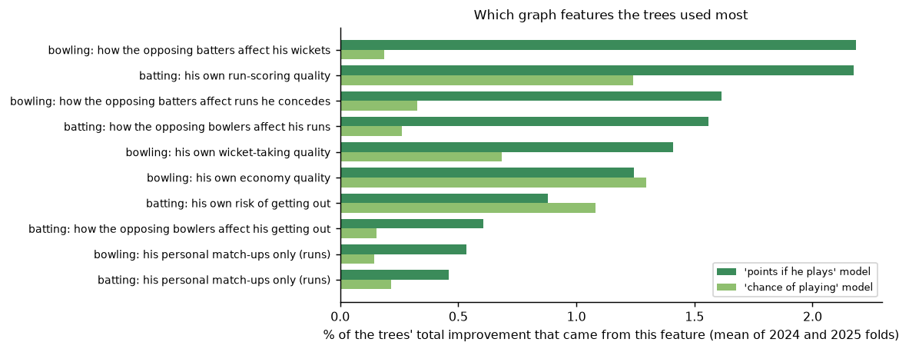

**Results.**

| | 2024 | 2025 |
|---|---|---|
| trees (B0s), share of the best possible XI | 62.45% | 62.84% |
| trees: our XI / best possible XI / a random legal XI (points) | 437.0 / 702.4 / 317.1 | 437.9 / 700.4 / 314.1 |
| trees: picked players who actually played | 85.7% | 86.2% |
| trees: MAE / RMSE, every squad member | 24.87 / 33.17 | 24.70 / 33.08 |
| trees: MAE / RMSE, players who played ($\mu$ only) | 26.44 / 34.44 | 26.44 / 34.47 |
| trees: playing model log-loss / Brier | 0.487 / 0.161 | 0.485 / 0.161 |
| trees + graph, share of the best possible XI | 62.36% | 63.08% |
| **trees + graph vs trees**, points per match | −0.77 [−2.10, +0.62] | **+1.59 [+0.23, +2.92]** |

**Why it performs like this.** The trees are the strongest model on fresh history and retrain in a minute on a CPU: with
$\Delta = 0$, hand-made selection features ("played the last match", rank inside the squad) are almost a lookup of the XI. The
graph adds a real gain in 2025 and grows with staleness (+1.4 at $\Delta = 0$ to +2.0 at $\Delta = 365$): who you face changes
much more slowly than form. Most of its value is *whom you face* (the quality of the opposing attack or batting); the pure pair
effect ("he is good against this particular bowler") carries about a quarter as much.

---

## 3. The final pipeline: refined network + batter–bowler graph (ADVM)

The refined network and the graph both help most when history is old, which is the hidden set's situation, so the final model
combines them: the cricket structure of section 2.2 and the match-up features of section 2.3.

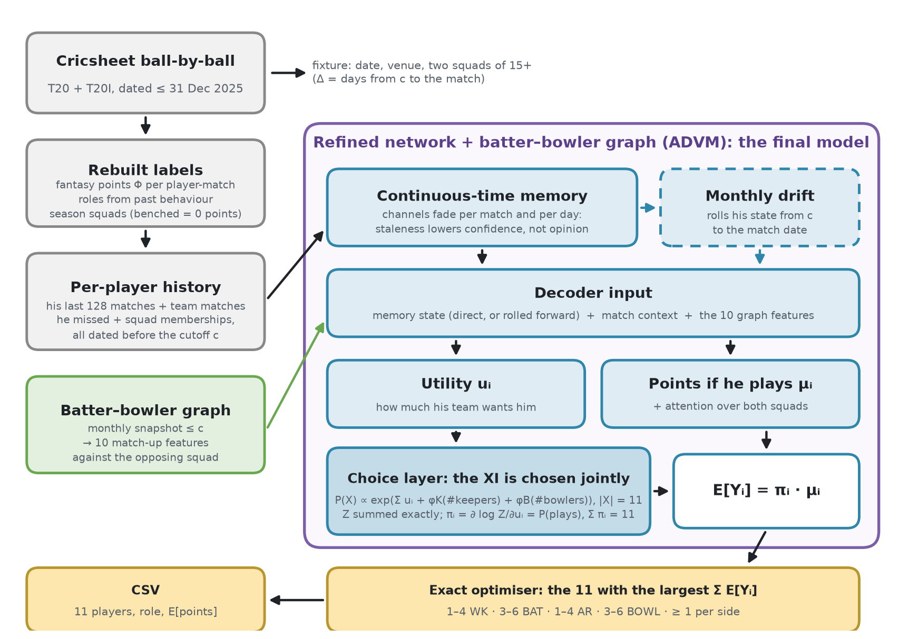

### 3.1 Model

The 10 graph features are appended to every candidate's decoder input in the refined network; they feed both the utility and
the points heads. Training **starts from the trained refined network of the same fold and seed**: the new inputs start with
zero weight, so at step 0 the model computes exactly what the refined network computed (checked: maximum difference 1e-5), and
fine-tuning then decides how much the graph is worth. The student (P4) is dropped. Code: `src/refined/` with the graph
features on (`src/train.py`, the default approach).

### 3.2 Loss and training

The same objectives as the refined network, with the extended decoder input:

```math
\mathcal{L}_{\text{P1}} = \frac{1}{n}\Big(\log Z - \sum_{i\in X^\ast}u_i - \varphi_K(K_{X^\ast}) - \varphi_B(B_{X^\ast})\Big)
+ \frac{1}{|\text{played}|}\sum_{i\in\text{played}}\Big(\frac{\mu_i - Y_i}{\sigma_\mu}\Big)^2,
\qquad
\mathcal{L}_{\text{P2}} = \tfrac{1}{N}\sum_k\lVert g(z_k,\cdot) - \mathrm{sg}(z_{k+1})\rVert^2,
\qquad
\mathcal{L}_{\text{P3}} = \mathcal{L}_{\text{P1}}\big(z^\ast = g^{\lceil\Delta/30\rceil}(z_c)\big)
```

Budget: P1 up to 4 epochs (patience 2, learning rate 5e-4), P2 2 epochs, P3 2 epochs; each seed picks its predictor (direct or
rolled forward) on validation; two seeds averaged. The model used for the hidden set is trained on matches from 2019 to
30 September 2025, early-stopped on October–December 2025, and reads every player's history up to 31 December 2025 when it
predicts.

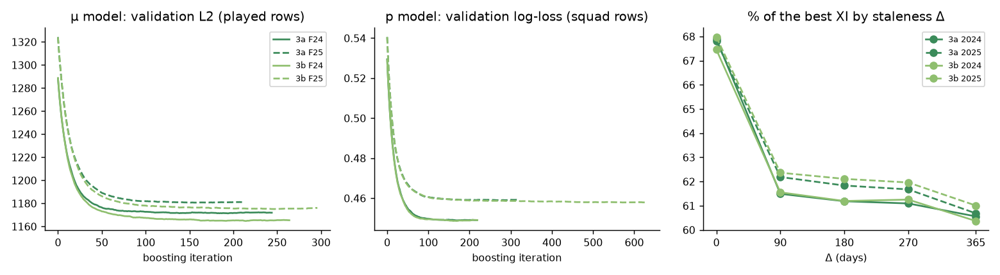

### 3.3 Results and why it is the final model

On the two walk-forward test seasons (each fold trained on data before the test year):

| final model (ADVM) | 2024 | 2025 |
|---|---|---|
| share of the best possible XI | 62.45% | **63.34%** (highest of all) |
| MAE, every squad member (sat-out = 0) | 25.79 | 25.35 |
| RMSE | 36.72 | 38.10 |
| rank correlation of players inside a match | 0.342 | 0.359 |
| vs the trees (B0s), points per match | −0.03 [−2.64, +2.44] | **+3.53 [+0.76, +6.40]** |
| vs the refined network without the graph (ADV) | **+0.86 [+0.26, +1.45]** | +0.71 [−0.26, +1.69] |
| vs the baseline (CB) | **+5.31 [+2.66, +8.03]** | **+5.47 [+2.79, +8.05]** |
| choice layer vs a simple "sum to 11" shift (same weights) | **+0.92 [+0.10, +1.71]** | +0.16 [−0.64, +0.98] |

*Points per match, paired bootstrap 95% intervals over about 1,800 test matches; bold = interval above zero. A team scores
about 440 points a match, so 3.5 points is about 0.8% of a team's score.*

How the history's age changes the comparison with the trees (descriptive, points per match):

| days of staleness $\Delta$ | 0 | 90 | 180 | 270 | 365 |
|---|---|---|---|---|---|
| 2024 | −5.49 [−9.05, −1.80] | −0.14 [−3.79, +3.76] | −0.74 [−4.37, +2.94] | +2.78 [−0.96, +6.56] | +3.44 [−0.12, +7.05] |
| 2025 | −2.85 [−6.47, +0.98] | **+5.03 [+1.27, +9.12]** | **+6.70 [+2.92, +10.63]** | +2.39 [−1.42, +6.23] | **+6.39 [+2.63, +10.10]** |

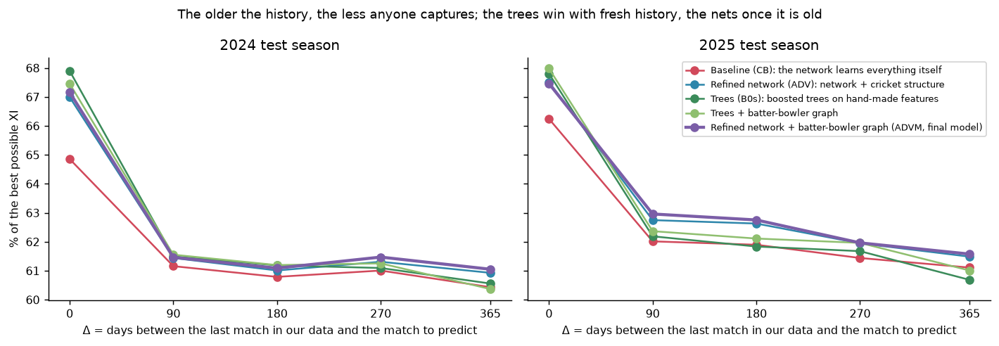

Why this is the final model:
- **the highest average in both test seasons** (62.45% in 2024, level with the trees; 63.34% in 2025, the highest of all five);
- **never clearly worse than any other model on the averages, and clearly better than** the trees in 2025, the refined
  network in 2024 and the baseline in both years;
- **it leads where the hidden matches are.** The trees' advantage is entirely on fresh history ($\Delta = 0$); with history
  90 days old or more, the final model is ahead or level in every cell, and clearly ahead in three of the 2025 cells. The
  hidden fixtures are 11 to 275 days after the last data (median 139);
- **both structural ideas in one model:** separating ability from competition for places, and the batter–bowler graph.

What it does not do: it is not better than the trees on fresh history, and its point *levels* are less calibrated than the
trees' (higher MAE and RMSE). Neither matters for the decision: the optimiser uses the order of $\mathbb{E}[Y_i]$ inside a match,
and the hidden matches are stale.

### 3.4 The optimiser

Given $s_i = \mathbb{E}[Y_i]$ for every candidate of both squads, the team is

```math
\max_{x\in\{0,1\}^N}\ \sum_i s_i x_i\quad\text{s.t.}\quad \sum_i x_i = 11,\quad
L_r \le \sum_{i:\,\text{role}_i = r} x_i \le U_r\ \ (r \in \{\text{WK},\text{BAT},\text{AR},\text{BOWL}\}),\quad
\sum_{i\in\text{team }t} x_i \ge 1\ \ (t = 1,2)
```

with $(L,U)$ = WK (1, 4), BAT (3, 6), AR (1, 4), BOWL (3, 6), solved exactly as an integer program (`scipy.optimize.milp`), ties
broken by player id. Because the expected team score is a sum, this is the best decision the predictions allow. Taking the top
11 and patching the roles afterwards can lose whenever a rule binds: a third keeper can be worth less than a fourth bowler even
with a higher personal score. Tested on 1,000 random squads: every rule holds and the answer is the same twice
(`tests/test_select.py`).

The gap between our XI and the best possible XI (about 37% of its points) is therefore not the optimiser's: the best possible XI
is picked with the real points $Y_i$, ours with $\mathbb{E}[Y_i]$ before the toss. Only better predictions can close it.

### 3.5 Hidden-set predictions

[`results/hidden_predictions.csv`](results/hidden_predictions.csv): the final model's teams for the 88 hidden fixtures
(2026-01-12 to 2026-10-03; 48 men's and 40 women's; IPL, WPL, internationals and other leagues). One row per picked player, 11 per
fixture, in descending order of predicted points:

```
Match_id,Match Date,Team 1,Team 2,Rank,Player,Player ID,Team,Role,Predicted Points,P(plays),Points If Plays
match_001,2026-04-25,Rajasthan Royals,Sunrisers Hyderabad,1,Abhishek Sharma,f29185a1,Sunrisers Hyderabad,BAT,50.99,0.984,51.81
```

Every fixture satisfies every team rule (11 players, 1–4 WK, 3–6 BAT, 1–4 AR, 3–6 BOWL, at least one from each side, all from
the given squads). Predicted team totals average 403 points (326 to 475); the average picked player plays with probability 0.82.

---

## 4. Conclusion

The three approaches tell one story. A model left to learn everything itself (the baseline) leaves points on the table; building
the problem's structure into the network (the refined network) recovers about 4.5 points a match; and the batter–bowler graph adds
more on top. The final model has both, and structure pays off most where history is stale, which is the setting of the real test.

Both structural ideas hold up. Separating ability from competition for places handles the missing-keeper case by construction,
and the batter–bowler graph adds a signal that grows with staleness. All five models end within about one point of each other
and far above a random team: the ceiling is the noise of a single match day (about 87% of a player's match-to-match variation),
not the pipeline.

Where I would take it next: graph edges that depend on the squad context and the innings phase (powerplay, death overs); a
final model trained from scratch rather than fine-tuned; and modelling the match-day noise itself (team totals, conditions)
rather than averaging over it.

---

## 5. How a model is judged

**Train, validate, test, walk-forward.** Each model learns from matches up to September of one year, uses October–December to
decide when to stop and which settings to keep, and is measured once on the whole next year, which it has never seen. This is
done twice, testing on 2024 and on 2025 (about 1,800 matches each).

**The score.** For every test match each model picks its 11; I add up the points those 11 actually scored and divide by the
points of the best possible legal 11 (picked in hindsight with the real points), then average over matches and over the five
staleness levels. The hidden set is scored by the sum of our 11's points, so this is the number models are selected on.

**MAE, RMSE and rank correlation are reported too, but MAE is not the selection metric.** Most squad rows are "sat out = 0",
and the minimiser of absolute error is the conditional *median*, which is 0 for anyone less than 50% likely to play; a model
trained to minimise MAE picked worse teams (−6.9 points a match). MAE also rewards accurate point levels, while the decision
only uses the order of expected points inside a match (the refined network has a higher MAE than the baseline and better
teams). Rank correlation inside a match is the closest standard metric to the decision; the share of the best possible XI is
the decision itself.

**Is a difference real or luck?** Two models differ by a few points a match while single matches swing by hundreds. So I take
the per-match differences (averaged over the staleness levels) and resample the ~1,800 test matches 2,000 times with replacement
(a paired bootstrap); the middle 95% of the resampled means is the interval reported, e.g. `+1.59 [+0.23, +2.92]`.

**The two-year rule**, written before any test number: a model counts as *clearly* better than another only if the whole interval
is above zero in both 2024 and 2025. Nothing was rerun or retuned after a test number was seen.

| by competition | |
|---|---|
| 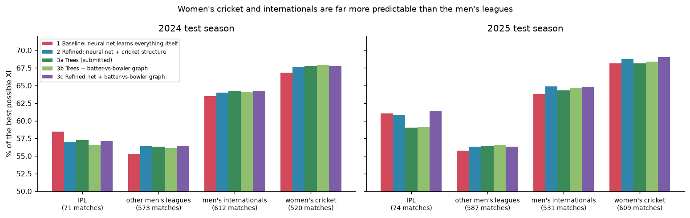 | Women's cricket (67–69% of the best XI) and men's internationals (64–65%) are far more predictable than men's leagues (55–61%). On the IPL the baseline is the best of the five in 2024 (about 70 matches a year). |

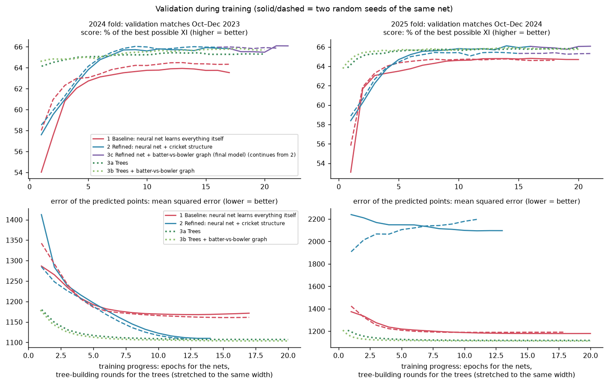

---

## 6. Leakage audit

- Matches after `--train-end` (2025-12-31) are dropped at ingestion, and the check is repeated when features are built
  (`assert` in `ingest.py`, `features.py`, `train.py`).
- Every feature goes through one strict "dated before" join (`src/shared/preprocessing/causal.py`); every row stores the latest
  date it used, and the audit asserts it is before the match (or the cutoff $c$).
- **Time-travel tests** rebuild rows from history truncated at the cutoff and demand bit-identical results: the tabular features
  (200 rows, `tests/test_causality.py`), the stale features (272 rows), the neural networks' inputs (388 and 305 candidates,
  `tests/test_baseline.py`, `tests/test_refined.py`) and the graph snapshots (gate G8: every snapshot's latest ball is before its
  date).
- Two of these tests caught real bugs on their first run (a same-day tie order, and an opponent read from rows after the
  cutoff); both were fixed before any result was produced.
- Per-stage audit reports: `data/audit/*.json`.

## 7. Assumptions

**Data and rules**
- Only T20 and T20I matches dated up to 31 Dec 2025 are used, for training and at prediction time.
- The fantasy score is the official points table plus 3 points for being in the XI, with no captain or vice-captain multiplier.
- Roles are inferred from each player's history unless the fixture gives them, in which case the given role wins.

**Squads and who plays**
- A training squad is everyone who played for that team in that competition and season (pseudo-squads); real squads can be larger
  or smaller, so the "sat out" rows are an approximation.
- The XI has 11 players, or 12 in impact-substitute competitions; at prediction time the refined network uses the size of the
  team's last XI before the cutoff.
- Rain-hit and no-result matches with some play are kept; players then score little more than the 3 points for playing.

**Time and staleness**
- The gap is stationary: the models learn how history before a cutoff maps to points after it from 2019–2025 gaps that start at
  any time of year, while the real gap starts on 1 January. The neural networks see the match month and the drift sees the season
  phase; the trees have no month feature.
- Training staleness is 0 or 1–450 days (`causal.py: draw_delta`); the hidden fixtures are 11–275 days after the cutoff, inside
  that range.
- The five staleness levels (0, 90, 180, 270, 365 days) count equally in every score.

**Evaluation**
- Past seasons are a fair stand-in for the hidden set; a different competition mix will score differently.
- Matches are independent for the bootstrap; matches in one series are correlated, so real intervals may be a little wider.
- Maximising expected points is the right goal for a sum-of-points score over many matches (the optimiser is risk-neutral).

## 8. How to run

```bash
python -m pip install -r requirements.txt           # Python 3.11+
bash run.sh                                         # download → every check → features + graph → the trees (CPU, ~30 min)
python src/run_kaggle.py                            # the networks on a GPU, in order: baseline, refined (2024 and 2025 folds),
                                                    # refined + graph, then the final model; resumable stage by stage
```

The final model starts from the trained refined network of the 2025 fold (`model_artifacts/checkpoints/ADV_F25_s0`, `_s1`), so
those runs come first; `src/run_kaggle.py` runs them in that order. With them in place, the two commands from the problem
statement are:

```bash
python src/train.py --train-start 2019-01-01 --train-end 2025-12-31 --device cuda      # the final model (GPU)
python src/evaluate.py --model-path model_artifacts/model_2025-12-31.pkl --test-file data/raw/test_fixtures.json --output results/hidden_predictions.csv
```

- `src/train.py --approach graph` trains the trees (CPU, a minute) → `model_trees_2025-12-31.pkl`; `--approach graph
  --graph-features` the trees + graph; `--approach baseline` and `--approach refined` (GPU) the two networks. `evaluate.py` reads
  which approach made a model from the model file.
- The GPU runs were done on Kaggle (2× T4) with `src/run_kaggle.py`: every stage is skipped once finished, and every run
  checkpoints each epoch (`model_artifacts/checkpoints/`) so a crashed run resumes.
- Seeds are fixed and LightGBM is deterministic; two runs of `evaluate.py` with the same model give byte-identical CSVs.
- Model weights are binary files and are not in the repository; the training commands rebuild them, and every run's per-epoch
  training and validation numbers are in `results/training_history/`.
- Figures: `python src/shared/evaluation/figures.py`.

## 9. Repository layout

```
src/
  train.py, evaluate.py         the two entry points (all approaches)
  shared/                       used by every approach
    ingestion/                  Cricsheet JSON → tables; the fixture file
    preprocessing/              fantasy points, roles, pseudo-squads, causal features, staleness helpers
    optimization/               the exact XI optimiser
    evaluation/                 metrics, reports, figures
    llm/                        open-weight LLM team overviews (optional bonus)
  baseline/                     Baseline (CB): config, ingestion, preprocessing, scoring_model, decision_model, pipeline
  refined/                      Refined network (ADV) and the final model (ADVM, with graph features): the same structure
  graph/                        Trees (B0s), the batter–bowler graph: preprocessing, scoring_model, ingestion, graph_model, experiments
  experiments/                  the experiments that shaped the trees
  run_kaggle.py                 resumable GPU runner
tests/                          points, causality, XI rules, baseline and refined model tests
data/
  raw/                          Cricsheet JSON + player registry (downloaded by run.sh, not committed)
  interim/, processed/          rebuilt by run.sh
  audit/                        one check report per stage
  mock/                         40 mock fixtures + their real points
model_artifacts/                (created by training, not committed) model weights and checkpoints
results/
  hidden_predictions.csv        the final model's predictions for the hidden test set
  figures/                      architecture diagrams
  overall/, baseline/, refined/, graph/     result figures and mock predictions
  experiments/                  every experiment's metrics, bootstrap and decision; LOG.txt = one line per run
  training_history/             every GPU run's per-epoch training and validation numbers (JSON)
  logs/                         the GPU training logs
```

## 10. Glossary

| term | meaning here |
|---|---|
| XI | the 11 players picked for a match |
| best possible XI (oracle) | the legal 11 with the most real points, picked after the match; the upper limit |
| $p$ (or $\pi$), $\mu$, $p\cdot\mu$ | chance he plays; points if he plays; expected points |
| $\Delta$, staleness | days between the last data used and the match |
| CB | the baseline network (history Transformer + squad Transformer) |
| ADV | the refined network (continuous-time memory, choice layer, monthly drift) |
| ADVM | the refined network + batter–bowler graph features: the final model |
| B0s | the trees: LightGBM $p\cdot\mu$ on hand-made, staleness-aware features |
| fold (2024 / 2025) | one train → validate → test split; the test is the named year |
| paired bootstrap, `[lo, hi]` | resample the test matches 2,000 times; 95% of the resampled mean differences fall in `[lo, hi]` |
| leakage | using information that would not exist before the match; tested against, never allowed |
