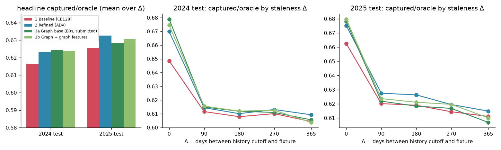
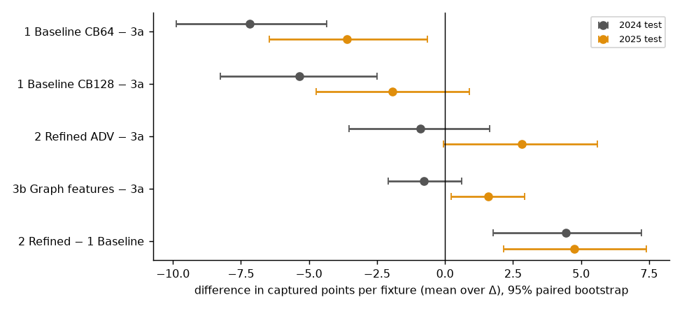

# sattebazi

Picking a fantasy cricket XI **before the toss**, from two squads and nothing after 31 December 2025.
Internal hackathon, Traditional ML track. Data: [Cricsheet](https://cricsheet.org) T20 and T20I matches only.

| | 2024 test | 2025 test | vs submitted model (captured pts / fixture, 95% CI) |
|---|---|---|---|
| **1 Baseline** (CB128, learns everything itself) | 0.6165 | 0.6254 | 2024 −5.34 [−8.26, −2.49] · 2025 −1.93 [−4.74, +0.90] |
| **2 Refined approach** (ADV, structured network) | 0.6234 | **0.6326** | 2024 −0.90 [−3.52, +1.63] · 2025 +2.82 [−0.06, +5.61] |
| **3a Graph approach, base** (LightGBM p·μ) **← submitted** | **0.6245** | 0.6284 | — |
| **3b Graph approach + batter×bowler graph** | 0.6236 | 0.6308 | 2024 −0.77 [−2.10, +0.62] · 2025 **+1.59 [+0.23, +2.92]** |

*Share of the best possible XI's points captured by the chosen XI (captured/oracle), mean over staleness Δ ∈ {0, 90, 180, 270, 365} days.*

---

## 1. Overview

Each candidate's fantasy score is `Y = 1[plays] · (3 + Φ(events))`, with Φ the official points table. The value of a team is a
sum, so the best team in expectation is the one with the largest Σ E[Y_i], and `E[Y_i] = P(plays) · E[points | plays]`.
The problem boils down to three pieces:

- **a probability model**: who plays, when the training data never shows benched players and competition for places matters;
- **a score model**: points if he plays, where most of the variation from match to match is luck (ICC ≈ 0.13);
- **a decision**: pick 11 under the fantasy rules, solved exactly as an integer program.

All of it has to work with history that stops on 31 Dec 2025, i.e. Δ days stale.

→ Full formulation, obstacles and how they are handled: [docs/overview.md](docs/overview.md).
Shared data pipeline and leakage audit: [docs/shared_pipeline.md](docs/shared_pipeline.md).
XI optimisation: [docs/optimization.md](docs/optimization.md). Evaluation protocol and metric choice: [docs/evaluation.md](docs/evaluation.md).

## 2. Approaches

| | approach | idea | description, code, results |
|---|---|---|---|
| 1 | **Baseline** | Transformer over raw history tokens + set decoder over both squads; one squared-error head on E[Y]. The network learns every mapping itself. | [src/baseline/](src/baseline/README.md) |
| 2 | **Refined approach** | Same inputs, with the problem's structure built in: a memory that fades in real time, separate "plays" and "points" heads, an exact constrained-choice layer for who plays, training on the matches inside the staleness gap | [src/refined/](src/refined/README.md) |
| 3 | **Graph approach** | 3a: LightGBM p·μ on engineered, staleness-aware features (the submitted model). 3b: + a batter × bowler interaction graph, factorised so it generalises to unseen pairs | [src/graph/](src/graph/README.md) |

Every approach shares the same ingestion, fantasy-points calculator, roles, pseudo-squads, evaluation and XI optimiser
(`src/shared/`), so differences in the results come from the models alone.

## 3. Overall results

**Validation during training** (the same validation windows for all three; captured/oracle and MSE of expected points):


**Test years** (headline, and by staleness Δ):



**Paired differences** (captured points per fixture, 2,000 bootstrap resamples):



What the results say:

1. **Nothing beats the gradient-boosted model in both years**, so under the pre-registered rules 3a is submitted. Independent
   Cricsheet projects on the same task report oracle capture of about 60% and R² ≈ 0.13 (ours: 62–63% averaged over the Δ grid, ICC ≈ 0.13):
   the ceiling is per-match noise, not the pipeline.
2. **Structure beats learning everything:** the refined approach beats the baseline by about +4.5 points per fixture in both
   years.
3. **Staleness changes the ranking.** 3a's whole lead comes from Δ = 0, where "played the team's last match" is fresh. At the
   stale gaps the hidden set will have (Δ ≳ 270 days), the refined approach and the graph features lead. The pre-registered
   headline averages all gaps, and the switch is not made after the fact.
4. **The graph idea carries real signal** (significant in 2025), mostly as opponent quality; the pair-specific part is smaller.

Player-level metrics the PS asks for (3a, 2025 test): MAE 24.70 and RMSE 33.08 on squad rows, MAE 26.44 and RMSE 34.47 on
played rows, within-fixture Spearman 0.361. Per-approach tables are in each approach's page; raw files in
[results/experiments/](results/experiments/) (one folder per experiment, one line per run in [LOG.md](results/experiments/LOG.md)).

## 4. How to run

```bash
python -m pip install -r requirements.txt           # Python 3.11+
bash run.sh                                         # download → gates → features → train 3a → hidden-set CSV (CPU, ~15 min after the download)
```

The two commands of the problem statement:

```bash
python src/train.py --train-start 2000-01-01 --train-end 2025-12-31
python src/evaluate.py --model-path model_artifacts/model_2025-12-31.pkl --test-file data/raw/test_fixtures.json --output results/hidden_predictions.csv
```

- Other approaches: `python src/train.py --approach baseline|refined --device cuda`, or `--approach graph --graph-features`.
  The evaluate command reads the approach from the model file.
- GPU runs (baseline, refined) were done on Kaggle with [notebooks/kaggle_notebook.ipynb](notebooks/kaggle_notebook.ipynb),
  which drives [src/run_kaggle.py](src/run_kaggle.py): stages are skipped once done, and every run checkpoints each epoch and
  resumes after a crash.
- Optional LLM team overviews (open weights, local): `LLM=1 bash run.sh` or [docs/llm_overview.md](docs/llm_overview.md).
- Determinism: fixed seeds, deterministic LightGBM, byte-identical CSVs from two runs (tested on Windows and Linux).

## 5. Repository layout

```
src/
  train.py, evaluate.py        the PS entry points (all approaches)
  shared/                      used by every approach
    ingestion/                 Cricsheet JSON → tables; the hidden fixture file adapter
    preprocessing/             fantasy points Φ, roles, pseudo-squads, causal features, staleness helpers
    optimization/              the exact XI integer program
    evaluation/                metrics, reports (E22, E23), figures
    llm/                       open-weight LLM team overviews
  baseline/                    1: config, ingestion, preprocessing, scoring_model, decision_model, pipeline + README
  refined/                     2: same structure + README
  graph/                       3: preprocessing, scoring_model, ingestion (graph), graph_model, experiments + README
  experiments/                 the exploratory experiments E2–E15 behind 3a
  run_kaggle.py                resumable GPU driver
tests/                         Φ band edges and golden matches, time travel, XI constraints, baseline and refined model tests
data/                          raw/ (downloaded, not committed), interim/, processed/ (rebuilt), audit/ (gate reports), mock/
model_artifacts/               model_2025-12-31.pkl (submitted, 3a), graph_features_*, baseline_cb128_*; checkpoints/ (histories)
results/                       overall/ baseline/ refined/ graph/ (figures, mock CSVs), experiments/ (every run's metrics)
docs/                          overview, shared pipeline, optimisation, evaluation, LLM; design/ = the design history
notebooks/                     Kaggle notebook
references/                    problem statement
```

## 6. Design history

The designs were written and pre-registered before the code: [docs/design/](docs/design/) holds the specification (SPEC),
the baseline and advanced designs, every interpretive decision with its alternatives (DECISIONS), all experiments
(EXPERIMENTS) and the reasoning log (THOUGHT_LOG).
