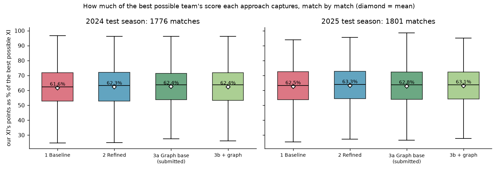
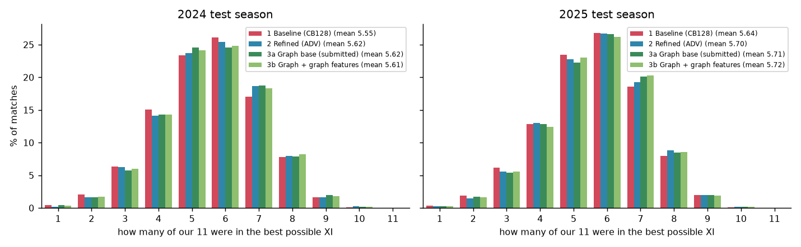

# sattebazi

Picking a fantasy cricket XI **before the toss**, from two squads and nothing after 31 December 2025.
Internal hackathon, Traditional ML track. Data: [Cricsheet](https://cricsheet.org), T20 and T20I matches only.

| approach | 2024 test | 2025 test | best-XI players in our 11 |
|---|---|---|---|
| 1 · Baseline: the model learns everything itself | 61.6% | 62.5% | 5.6 |
| 2 · Refined: my understanding built into the network | 62.3% | **63.3%** | 5.7 |
| **3a · Graph approach, base (submitted)** | **62.4%** | 62.8% | 5.7 |
| 3b · Graph approach + batter × bowler graph | 62.4% | 63.1% | 5.7 |

*Share of the best possible XI's points that our XI actually scored, averaged over every test match and over how stale the
history is (Δ = 0 to 365 days). Last column: how many of our 11 were in the best possible XI.*

---

## 1. The problem, the way I see it

We get a fixture (a date, two teams, sometimes a venue) and two squads of 15 or more players. We have to pick 11, respecting the
fantasy rules (1–4 keepers, 3–6 batters, 1–4 all-rounders, 3–6 bowlers, at least one player from each side), so that those 11
score as many fantasy points as possible in the real match.

When I look at a player before a match, I see two kinds of information, and both need to be modelled:

- **the temporal side:** his history. How he has been scoring, how his form moves, how often he has been picked lately, and
  how old all of that is by the time the match is played;
- **the present side:** the squad he is in and the one he is up against. Who else is competing for his place, which opponent he
  faces, where and in which competition.

His fantasy score is `Y = 1[he plays] · (3 + Φ(what he does in the match))`, where Φ is the official points table. The table is
exact, but what happens in the match is mostly luck: only about 13% of the match-to-match variation in points is explained by
who the player is.

A team's score is a sum, so the best team *in expectation* is the one with the largest sum of expected scores. And

    E[Y] = P(he plays) × E[points | he plays] = p · μ

So the whole problem boils down to three things:

1. **a probability model** for p, who plays. Hard, because Cricsheet only lists the XI: benched players never appear, so the
   training data has no negatives. A backup keeper looks like a player who "never plays" until the first-choice keeper is missing.
2. **a score model** for μ, points if he plays. Hard, because it is noisy, heavy-tailed and non-linear (milestones and
   strike-rate/economy bands depend on the tails, not the average).
3. **a decision:** pick the 11. That part is easy to do exactly: a small integer program (section 3).

The obstacles I had to get past before any of that:

| obstacle | what I did |
|---|---|
| training data has no squads, only XIs | rebuilt **pseudo-squads**: everyone who played for the team in that event and season. The benched members become rows with Y = 0 |
| roles are not in the data | inferred them from each player's history before the match (stumpings, catches, share of overs, batting position): 99.3% of real XIs come out feasible |
| history stops at 2025-12-31, the fixtures are later | every model is trained and tested with **simulated staleness**: history cut Δ days before the match (Δ up to 450 in training, and 0, 90, 180, 270, 365 in testing) |
| leakage | one as-of join for every feature (strictly earlier dates only), and time-travel tests that rebuild features from truncated history and demand exact equality |
| noise | judge with the task's own metric (points of the chosen XI), paired bootstrap over matches, and every decision rule written down before seeing a test number |

## 2. How I judge a team

For every match in a test season, each approach picks its XI. **Captured** is what those 11 actually scored; the **best
possible XI** is the best valid team in hindsight. I report captured as a % of the best possible XI, averaged over matches and
over the five staleness values. That is exactly how the hidden set is scored (the sum of our 11's points), so it is the metric
I select on.

The problem statement also asks for MAE and another metric: they are in every results table below (MAE, RMSE, and the rank
correlation inside a match). I don't select on MAE. Most squad rows are benched zeros, most of the variance is luck, and the
model that minimises MAE predicts the median, which is 0 for anyone less than 50% likely to play. When I trained that model it
picked worse teams (−6.9 points a match). Rank losses (LambdaRank, ListNet, SPO+) tied or lost too.

Folds are walk-forward: train up to September, validate on October–December, test on the next full year (2024: 1,776 matches;
2025: 1,801). The rule for replacing the model I submit: the new one must beat it with a 95% paired-bootstrap interval above zero
**in both 2024 and 2025**, and nothing is rerun or retuned after a test number is seen.

## 3. What all three approaches share

The spine is the same for every approach, so any difference in the results comes from the models.

| step | code | what it does | check |
|---|---|---|---|
| ingestion | `src/shared/ingestion/ingest.py` | Cricsheet JSON → match and player-match tables. T20/IT20 dated ≤ 2025-12-31 only (13,085 matches; 7,862 Test/ODI files skipped), registry IDs as the player key, super overs excluded | file counts, delivery invariants |
| fantasy points | `src/shared/preprocessing/points.py` | the official table as 13 components | band edges and golden matches re-scored independently (`tests/test_points.py`) |
| roles | `src/shared/preprocessing/roles.py` | keeper / batter / all-rounder / bowler as of each date; used only when picking the XI | 99.33% of real XIs feasible |
| pseudo-squads | `src/shared/preprocessing/squads.py` | the candidate set with benched rows (median 15 players) | < 0.5% smaller than 11 |
| causal features | `src/shared/preprocessing/causal.py`, `features.py`, `context.py` | form, opportunity, appearance shares, squad ranks, opponent and venue, all via one strict as-of join | time-travel test on 200 rows (`tests/test_causality.py`) |
| **picking the XI** | `src/shared/optimization/selection.py` | maximise Σ x_i · E[Y_i] with 11 players, the role bounds and ≥ 1 per side, solved exactly (`scipy.optimize.milp`), ties broken by player id | 1,000 random squads: every rule holds, same answer twice (`tests/test_select.py`) |
| test fixtures | `src/shared/ingestion/fixtures.py` | reads the hidden fixture file (several layouts), resolves names to player IDs, prints the resolution rate | |
| evaluation | `src/shared/evaluation/` | best possible XI, captured, rank correlation, bootstrap, reports and figures | |
| LLM overview (bonus) | `src/shared/llm/team_overview.py` | a local open-weight model (Qwen2.5-0.5B-Instruct, Apache-2.0, CPU) writes a short paragraph per predicted XI. The code computes the facts (composition, team split, top picks, playing risks) and prints them above each paragraph, and the model only phrases them. Greedy decoding, so the text is reproducible. Example: `results/mock_team_overviews.txt` | |

Why an exact integer program: the expected team score is a plain sum, so maximising Σ x_i E[Y_i] under the rules is the best
decision the model can make. Picking the top 11 and then repairing the roles can lose to it whenever a role bound binds (a third
keeper can be worth less than a fourth bowler).

**Leakage audit.** Matches after `--train-end` are dropped at ingestion and the check is repeated at feature time. Every feature
goes through one strict as-of join. Every row stores the latest date it used, and the audit asserts it is before the cutoff.
Time-travel tests rebuild rows from truncated history: the tabular features (200 rows), the stale features (272 rows at
Δ > 0), the baseline's and refined model's history tokens (388 and 305 candidates), and the graph snapshots (a snapshot refitted
from truncated data is bit-identical). Two of these tests caught real bugs on their first run (a same-day tie order, and an
opponent read from rows after the cutoff), both fixed before any result was produced.

## 4. Approach 1: Baseline, the model learns everything itself

**The thought.** Before I put any of my ideas in, I want to know what a model finds on its own. So the baseline is naive about
cricket on purpose. It never hears "keeper", "form" or "probability of playing". I force it to map everything intrinsically, and
I need these results as the reference every idea has to beat.

```
the raw history of every squad member (his last L matches, all dated before the cutoff)
   → a Transformer reads each player's history              (temporal side)
   → a second Transformer lets all players of both squads see each other and the fixture   (present side)
   → one number per player: his expected fantasy score     → the XI program
```

- Each history **token** is one past match: 16 raw counts (runs, balls, fours, sixes, wickets, dots, catches, …), the fantasy
  points he scored, the context (format, event, venue, opponent, team) and how old it is. A second kind of token marks every
  match of his team he *missed* in the last year, so the model can see who is a regular and who was dropped.
- The fixture token says what match it is and how stale the history is (Δ).
- It is trained with plain squared error on Y, benched players included. The best possible answer to squared error is the
  average, and the average of Y is p·μ, so it has to learn "plays" and "points if plays" together without being told.
- Two history lengths, 64 and 128 matches, two seeds each; the two seeds are averaged. 128 won on validation.

**Code** (`src/baseline/`): `config.py` (the fixed training budget) · `ingestion.py` (history → token store) ·
`preprocessing.py` (squads, staleness per match and epoch, token tensors) · `scoring_model.py` (the two Transformers) ·
`decision_model.py` (score → XI, validation metric) · `pipeline.py` (training with a checkpoint every epoch and resume,
packaging, prediction). Tests: `tests/test_baseline.py` (causality, time travel, the absence-token rule, permutation, cold start).
Trained on Kaggle (2× T4): 12 runs in 3.4 h.

**Results.**

| | 2024 | 2025 |
|---|---|---|
| % of best possible XI (CB128) | 61.6 | 62.5 |
| vs the submitted model, points per match | −5.34 [−8.26, −2.49] | −1.93 [−4.74, +0.90] |
| 128 vs 64 matches of history | +1.83 [−0.11, +3.81] | +1.67 [−0.21, +3.53] |
| MAE / RMSE, squad rows | 24.75 / 33.91 | 24.22 / 33.67 |
| rank correlation inside a match | 0.318 | 0.341 |
| predicted team total vs real | −13% | −16% |


**What I read from it.** It does learn the task (0.54 → 0.65 on validation), but it does not beat the engineered model.
Nothing tells it that exactly 11 players take the field, and it under-predicts team totals by 13–16%. Two things surprised me:
on IPL matches it is the best of all four (small sample, about 70 matches a year; section 7), and its whole gap is at Δ = 0.
When everyone's history is a year old, it is level with the engineered model.

## 5. Approach 2: Refined approach, my understanding built into the network

**The thought.** Same inputs, same training data as the baseline, but now I give the network the structure I believe the
problem has. Every piece is switchable, so I can see what each one is worth.

- **Memory should fade in real time, not per row.** A player's form from two years ago matters less than last month's, and
  staleness should make the model *less sure*, not change its opinion. So the history is read by a recurrent memory whose
  channels decay per match and per day (a continuous-time WKV). When I set it up with constant keys it reproduces exactly the
  bank of moving averages the engineered model uses (tested to 1e-16), and a gap without matches only lowers its confidence.
- **"Plays" and "points if plays" are different questions**, so there are two heads, bound to what the player can do (keeper,
  bowling option, batting depth).
- **Who plays is a choice among the squad, not eleven separate yes/no questions.** If two keepers are in the squad and only
  one plays, the backup is not a bad player; he is second in line. So the decision model scores an XI as a whole:
  P(XI) ∝ exp(Σ utility of each player + a term for the number of keepers + a term for the number of bowling options), with
  exactly 11 (or 12 where impact subs exist). The normaliser is computed exactly by dynamic programming, and each player's
  probability of playing is its gradient. When the first-choice keeper is absent, the backup's probability goes up by itself.
- **Context scales everyone** (a flat pitch lifts every batter), so the fixture context rescales every player's vector, and
  **squad attention** lets the points head see who else is playing (a missing opener pushes No. 3 up the order).
- **Learn from what happens inside the staleness gap.** In training I know the matches between the history cutoff and the
  fixture; at test time I don't. So a month-by-month transition of the player's state is learned from those matches and used at
  test time to roll the December state forward to the match date. Then a one-pass student is distilled from it.

Prediction: E[Y] = P(plays from the choice model) × points if plays. Four training phases: the encoder and heads, then the
monthly transition, then the heads again on rolled-forward states, then the student. Each seed picks its final predictor on
validation. Not built: a full innings simulator (it needs over-by-over bowling sequences the ingestion does not extract) and an
overseas-player term.

**Code** (`src/refined/`): `config.py` · `ingestion.py` (the baseline tokens + squad-membership tokens, capabilities as of the
cutoff, XI size) · `preprocessing.py` · `scoring_model.py` (memory, heads, attention, transition, student) ·
`decision_model.py` (the exact choice model over the squad) · `pipeline.py` (the four phases, checkpointed, resumable).
Tests: `tests/test_refined.py` (the memory reproduces moving averages, staleness only lowers confidence, gap matches never leak,
the choice model equals brute force over all 364 subsets of a 14-player squad, and the rest). Trained on Kaggle: 4 runs in 2.9 h.

**Results.**

| | 2024 | 2025 |
|---|---|---|
| % of best possible XI | 62.3 | **63.3** |
| vs the submitted model | −0.90 [−3.52, +1.63] | +2.82 [−0.06, +5.61] |
| **vs the baseline** | **+4.45 [+1.77, +7.22]** | **+4.76 [+2.15, +7.40]** |
| choice model vs a simple sum-to-11 shift (same weights) | +0.49 [−0.35, +1.27] | −0.47 [−1.27, +0.37] |
| roll-forward vs direct | +0.91 [−0.07, +1.94] | +0.17 [−0.76, +1.08] |
| MAE / RMSE, squad rows | 25.90 / 36.78 | 25.53 / 38.33 |
| rank correlation inside a match | 0.341 | 0.359 |

vs the submitted model, by how stale the history is (points per match):

| Δ (days) | 0 | 90 | 180 | 270 | 365 |
|---|---|---|---|---|---|
| 2024 | −6.7 | −0.3 | −1.4 | +1.4 | +2.5 |
| 2025 | −2.4 | +3.3 | **+5.6** | +2.1 | **+5.5** |


**What I read from it.** Putting my understanding into the architecture pays: about +4.5 points a match over the baseline in
both years. Against the engineered model it ties on the average, but the average hides the pattern. The engineered model wins
only when history is fresh (Δ = 0), where "played the team's last match" is a strong signal. As history gets older, which is
exactly the hidden set's situation, the refined model leads, significantly at 180 and 365 days in 2025. The choice model ties
the simple shift on picked points: the ordering of who is likely to play barely changes. The roll-forward helps a little and
was picked by 3 of 4 seeds. The student failed: it sees neither the squad nor the choice model, so it cannot learn competition
for places. One more thing: its expected points rank well but are badly calibrated in level in 2025 (validation MSE about 2,100
against 1,180 for the others, see section 7). The XI only needs the ranking, so the picks don't suffer.

## 6. Approach 3: Graph approach

**The thought.** Players don't score in a vacuum. A batter's runs depend on who bowls to him, and a bowler's wickets on whom
he bowls to. That is a graph: every ball is an edge between a batter and a bowler. But first the approach needs a strong base.

**3a, the base (the submitted model).** The p·μ decomposition done the engineered way:

- p: a LightGBM classifier on squad rows (benched = 0), then one shift per team so the probabilities add up to 11;
- μ: a LightGBM regressor on the rows of players who played;
- score = p·μ → the XI program;
- features, all strictly before the cutoff: form as moving averages at three memory lengths (3, 10, 30 matches) plus career
  means, opportunity (batting position, balls faced and bowled), how often he played for this team recently, where he ranks
  inside his own squad, role evidence, the strength of his own and the opposing squad, and a shrunk venue average;
- **staleness-aware:** every row is built as of the cutoff, gaps are measured to the match date, and Δ itself is a feature.

Before the final run, about 60 small walk-forward experiment runs decided what 3a contains: the noise ceiling, the memory
length, the loss, the appearance model, structure in the training algorithm (all ties), and opponent/venue context (the one
replicated gain, +2.6 points a match). The code is in `src/experiments/`, one line per run in `results/experiments/LOG.txt`.

**3b, the batter × bowler graph.**

1. **Edges.** 645k batter–bowler records (one per pair per match), 2.87M balls. For runs and for dismissals separately, a pair's rate is
   `balls × exp(base + batter quality + bowler quality + batter vector · bowler vector)`.
2. **Generalising.** The vectors are short (4 numbers), so a batter who handles a *kind* of bowler handles every bowler of that
   kind, including ones he has never faced. The bowler vectors group bowlers by type without any label (Cricsheet has no
   bowling-style field), and priors shrink pairs with few balls.
3. **No leakage.** The graph is refitted every month on balls bowled before that month (100 snapshots, 2017-10 → 2026-01), and
   a row with cutoff c uses the latest snapshot on or before c.
4. **Before the toss** nobody knows who bowls to whom, so each player gets the expected effect over the opponent squad,
   weighted by how likely each opponent is to play and bowl (or bat): 10 features added to 3a.

**Code** (`src/graph/`): `preprocessing.py` (stale feature table + its time-travel gate) · `scoring_model.py` (the LightGBM p
and μ) · `ingestion.py` (the ball-level graph) · `graph_model.py` (the factorisation, monthly snapshots, graph features for
training and test, its gate) · `experiments.py` (`ingest`, `snapshots`, `features`, `g8`, `folds`, `e24`) · the decision is
p·μ → the shared XI program. 3a trains in about a minute on a CPU; the graph takes about 15 minutes.

**Results.**

| | 2024 | 2025 |
|---|---|---|
| **3a, % of best possible XI** (submitted) | **62.4** | 62.8 |
| 3a: our XI / best possible XI / a random valid XI (points) | 437.0 / 702.4 / 317.1 | 437.9 / 700.4 / 314.1 |
| 3a: share of our picks who actually played | 85.7% | 86.2% |
| 3a MAE / RMSE, squad rows | 24.87 / 33.17 | 24.70 / 33.08 |
| 3a MAE / RMSE, players who played (μ) | 26.44 / 34.44 | 26.44 / 34.47 |
| 3a rank correlation inside a match | 0.346 | 0.361 |
| 3a playing model: log-loss / Brier | 0.487 / 0.161 | 0.485 / 0.161 |
| 3b, % of best possible XI | 62.4 | **63.1** |
| **3b vs 3a**, points per match | −0.77 [−2.10, +0.62] | **+1.59 [+0.23, +2.92]** |


**What I read from it.** 3a is the best when history is fresh and the best on average in 2024, so it is the one I submit (and
it retrains in a minute). The graph adds a significant +1.6 points a match in 2025, growing with staleness, and ties in 2024, so
under my two-year rule 3a stays. Most of the graph's gain is *whom you face* (the opponent's quality). The pure pair effect,
"he is good against this particular bowler", carries about a quarter as much. Where I want to take it next: a graph network
whose edges depend on the squad context, edges split by innings phase (powerplay / death), and the graph features inside the
refined model, since both help most when history is old.

## 7. Overall results

Validation, the same windows for all three (October–December before each test year):


Every test match: how much of the best possible XI each approach captured.



By competition:


How many of our 11 were in the best possible XI:



And the thing that changes the ranking, how stale the history is:


What I take away:

1. **Nothing beats the engineered model in both years**, so 3a is submitted. Other Cricsheet projects on the same task report
   about 60% of the best possible XI and R² ≈ 0.13; we are at 62–63%, with the same ≈ 13% of explainable variance. The ceiling
   is match-to-match luck, not the pipeline.
2. **Structure beats learning everything:** the refined model beats the baseline by about 4.5 points a match in both years.
3. **Staleness decides who wins.** The engineered model's lead is entirely at Δ = 0. At the gaps the hidden set will have
   (roughly 270+ days), the refined model and the graph features are ahead. My rule averages all gaps, because the test gap was
   unknown when I wrote it, and I don't switch after the fact.
4. **Competitions differ a lot:** women's cricket (67–69% of the best XI) and men's internationals (64–65%) are far more
   predictable than the men's leagues (55–61%). On the IPL, the baseline that learns everything itself is the best of the four,
   though that is only about 70 matches a year.

Every number comes from files in `results/experiments/` (one folder per experiment: metrics, bootstrap, decision), and every
figure is drawn by `src/shared/evaluation/figures.py` from those files.

## 8. How to run

```bash
python -m pip install -r requirements.txt           # Python 3.11+
bash run.sh                                         # download → checks → features → train 3a → hidden-set CSV
```

`run.sh` downloads Cricsheet if `data/raw/` is empty and stops at the first failed check. It takes about 15 minutes on a CPU
after the download. Options: `GRAPH_FEATURES=1` (build the graph and train 3b), `NEURAL=1` (train the baseline and refined
models, GPU), `LLM=1` (write the team overviews).

The two commands from the problem statement:

```bash
python src/train.py --train-start 2000-01-01 --train-end 2025-12-31
python src/evaluate.py --model-path model_artifacts/model_2025-12-31.pkl --test-file data/raw/test_fixtures.json --output results/hidden_predictions.csv
```

- `src/train.py --approach baseline | refined --device cuda`, or `--approach graph --graph-features`, trains the others.
  `evaluate.py` reads which approach made a model from the model file.
- The GPU runs were done on Kaggle with `src/run_kaggle.py`: it runs everything in stages, skips a stage once it is done, and
  every training run saves a checkpoint each epoch and resumes after a crash.
- Seeds are fixed and LightGBM is deterministic. Two runs of `evaluate.py` give byte-identical CSVs, on Windows and on Linux.
- Dry run without the hidden file: `--test-file data/mock/test_fixtures.json` (40 real fixtures from Oct–Dec 2025).

## 9. Repository layout

```
src/
  train.py, evaluate.py         the two entry points (all approaches)
  shared/                       used by every approach
    ingestion/                  Cricsheet JSON → tables; the hidden fixture file
    preprocessing/              fantasy points, roles, pseudo-squads, causal features, staleness helpers
    optimization/               the exact XI program
    evaluation/                 metrics, reports, figures
    llm/                        open-weight LLM team overviews
  baseline/                     1 · config, ingestion, preprocessing, scoring_model, decision_model, pipeline
  refined/                      2 · the same structure
  graph/                        3 · preprocessing, scoring_model, ingestion (graph), graph_model, experiments
  experiments/                  the experiments that shaped 3a
  run_kaggle.py                 resumable GPU runner
tests/                          points, causality, XI rules, baseline and refined model tests
data/
  raw/                          Cricsheet JSON + player registry (downloaded by run.sh, not committed)
  interim/, processed/          rebuilt by run.sh
  audit/                        one check report per stage
  mock/                         40 mock fixtures + their real points
model_artifacts/                model_2025-12-31.pkl (submitted, 3a), graph_features_*, baseline_cb128_*;
                                checkpoints/ = best weights and training history of every GPU run
results/
  overall/, baseline/, refined/, graph/     figures and mock predictions
  experiments/                  every experiment's metrics, bootstrap and decision; LOG.txt = one line per run
  logs/                         the GPU training logs
```
